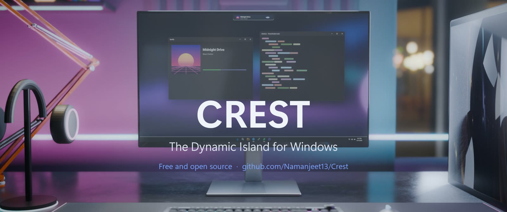
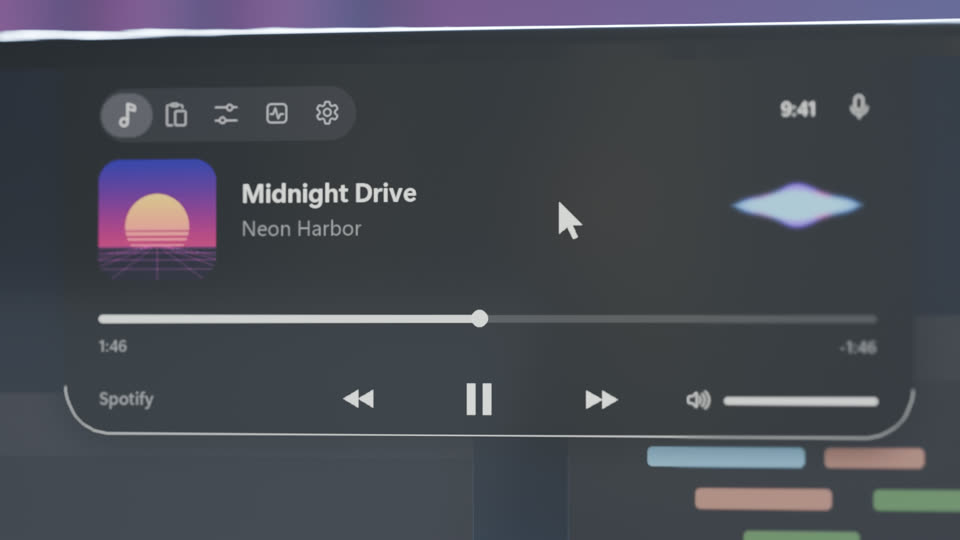
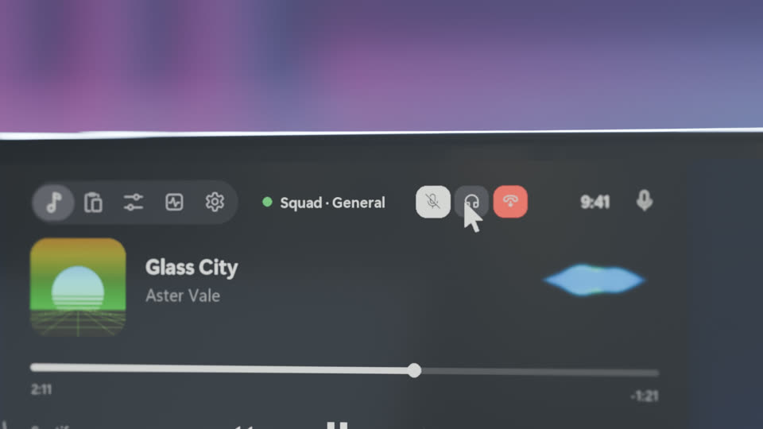
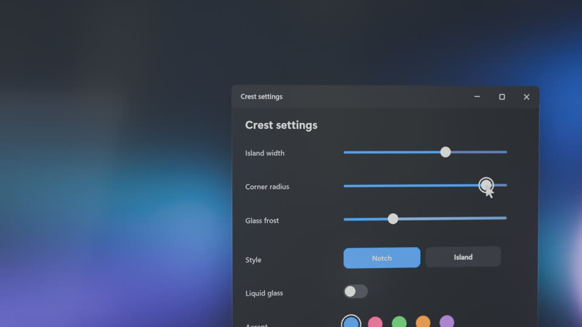
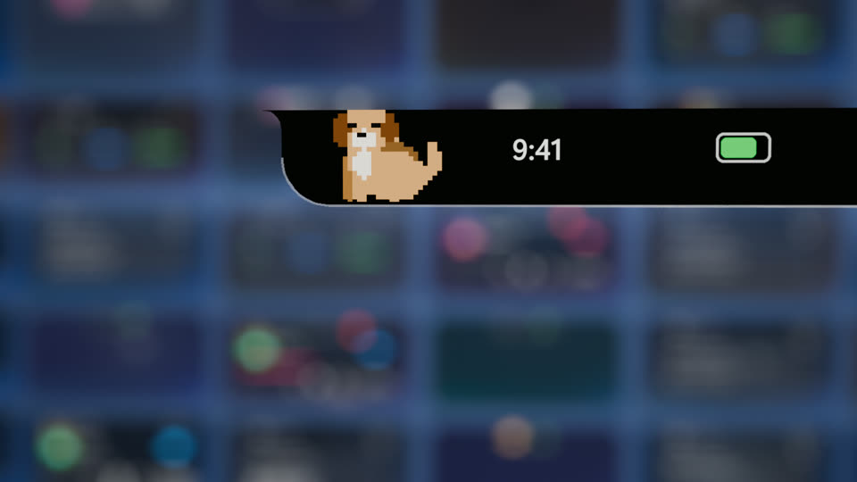

<p align="center">
  
</p>

<h1 align="center">Crest</h1>

<p align="center">
  <b>A free, open-source Dynamic Island for Windows.</b><br>
  A small black notch at the top of your screen shows what's happening and springs open when you hover over it.
</p>

<p align="center">
  <a href="https://github.com/Namanjeet13/Crest/releases/latest"></a>
  
  
  <a href="LICENSE"></a>
</p>

---

## Install

1. Download **CrestSetup.exe** from the [latest release](https://github.com/Namanjeet13/Crest/releases/latest).
2. Run it. It installs for your account only, so it doesn't need admin rights, and it includes its own .NET runtime.
3. Crest appears at the top of your screen. Hover over it to open it, or press **Ctrl+Alt+N**.

Windows SmartScreen may warn you because the installer isn't code-signed. Choose **More info › Run anyway**, or [build it yourself](#build-from-source).

To remove Crest, go to **Settings › Apps › Installed apps › Crest › Uninstall**.

## What it does

<table>
  <tr>
    <td width="50%"></td>
    <td width="50%"></td>
  </tr>
  <tr>
    <td><b>Now playing</b>: artwork, seek, play/pause and a live visualizer, from any app.</td>
    <td><b>Discord voice</b>: mute, deafen or leave a call without opening Discord.</td>
  </tr>
  <tr>
    <td></td>
    <td></td>
  </tr>
  <tr>
    <td><b>Make it yours</b>: notch or floating island, size, corners, glass and accent colour.</td>
    <td><b>Pixel pet</b>: a cat, dog or bunny that lives in the idle island.</td>
  </tr>
</table>

<sub>The images are frames from Crest's launch trailer.</sub>

- **Notch or floating island.** It uses spring-physics animations, never steals focus and stays out of Alt+Tab. You can drag it along the top edge.
- **Now playing** from any app (Spotify, browsers, media players). You get artwork, an accent colour taken from the album, seek, play/pause, next and previous, and a live visualizer. Click the song to jump to the app or browser tab that's playing it. If nothing is playing, play starts Spotify minimized and resumes your last song.
- **Peeks.** Brief pop-ups for volume changes, track changes, mic mute, clipboard copies and picked colours, and when an app starts using your mic.
- **One mute for every app** (Ctrl+Alt+M). A call pill with a timer appears while any app uses your mic.
- **Discord voice controls.** Mute, deafen and leave a voice channel, even while Discord is minimized or closed to the tray. You don't need to link an account or add a bot. Needs Discord set to English.
- **Privacy dots** for mic and camera use.
- **Clipboard history** (Ctrl+Alt+V), with pinning. It's encrypted on disk with Windows DPAPI and skips anything a password manager marks as private.
- **Quick controls.** Volume, brightness on laptops, Wi-Fi, Bluetooth, Snip, Night light, and a colour picker (Ctrl+Alt+C).
- **System.** CPU, memory, battery and uptime.
- **Pixel pet.** It blinks, yawns and curls up asleep when you're away, and shows hearts when you rest the pointer on it. It hides for music, calls and fullscreen.
- **Settings.** Shape, size, hide until hover, hide in fullscreen, start with Windows, visualizer, peeks, Discord and pet.

### Keyboard shortcuts

| Shortcut | Action |
|---|---|
| Ctrl+Alt+N | Open or close the island |
| Ctrl+Alt+M | Mute or unmute your mic in every app |
| Ctrl+Alt+V | Clipboard history |
| Ctrl+Alt+C | Pick the colour under the pointer |

You can turn each shortcut off in Settings.

## Privacy

Crest runs entirely on your PC. It has no account, telemetry, analytics or ads, and it makes no network requests of its own.

- Settings and clipboard history are stored in `%AppData%\Crest`. Clipboard history is encrypted so only your Windows account can read it.
- Media info comes from Windows' own media controls. Mic and camera activity comes from Windows' privacy records, which Crest only reads.
- Discord controls work by pressing Discord's own buttons through Windows UI Automation. Crest never reads your messages or touches your login.

## Build from source

You need Windows 10 2004 or later and the [.NET 8 SDK](https://dotnet.microsoft.com/download/dotnet/8.0).

```powershell
git clone https://github.com/Namanjeet13/Crest.git
cd Crest
dotnet run --project src/Crest
```

To build the installer (`dist\CrestSetup-<version>.exe`):

```powershell
powershell -ExecutionPolicy Bypass -File installer\build.ps1
```

### Project layout

```
src/Crest/
  NotchWindow.xaml(.cs)   the island: layout, states, peeks, hotkeys
  SettingsWindow.cs       the settings app
  Animation/              spring physics
  Controls/               glass, pixel pet, ring, scrubber, slider, waveform
  Services/               media, audio, clipboard, privacy, Discord, system
  Shaders/                the liquid-glass pixel shader (HLSL)
installer/                Setup.exe and Uninstall.exe (one small C# file each)
```

## Contributing

Bug reports, ideas and pull requests are all welcome. See the [roadmap](ROADMAP.md) for what's planned. To report a security problem, see [SECURITY.md](SECURITY.md).

## Licence

[MIT](LICENSE). Crest isn't affiliated with Apple. "Dynamic Island" describes the idea, not a product.
